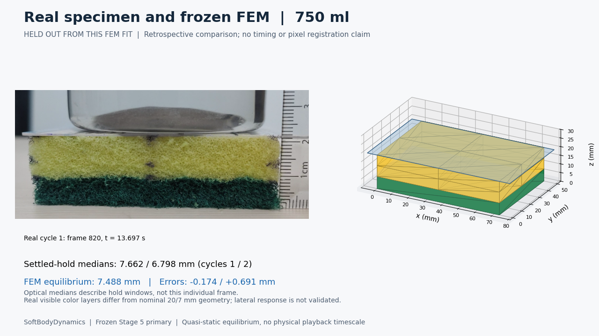

# SoftBodyDynamics

An observation-calibrated, quasi-static 3D tetrahedral FEM model of a sponge under **full-face compression**. Video-derived compression at the first 500/1000 ml cycles fits the material scale **mu = 6999.814990181902 Pa**; force drives the solved mesh, rather than replaying recorded motion.

**[Watch the existing 45.2-second demo](demo/outputs/demonstration.mp4)** · [GIF fallback](demo/outputs/demonstration.gif) · [Real-versus-simulation comparison](demo/outputs/comparison_750ml.png) · [Comparison viewer](demo/outputs/index.html)

From the repository root, with dependencies installed and **new output directories**:

```powershell
python -B -m analysis.localized_fem.simulator full-face --force 6.5 --output runs/fullface
python -B -m analysis.localized_fem.simulator localized --force 0.3 --patch-length-mm 20 --patch-width-mm 30 --center-x-mm 18.25 --center-y-mm 25 --mesh 2 2 1 --output runs/localized
```

The first command runs the **frozen primary simulator** (about 5.10350 mm compression). The second is an inexpensive **experimental traction-patch example**, not validated rigid-card/fingertip contact. Both export reference/solved vertices, elements, applied loads, reactions, convergence diagnostics and a static 3D image. Localized force is in N; patch lengths/coordinates are in mm. Use `--help` for options.

**Limits:** the 500 ml calibration mismatch remains; evaluation is retrospective, not independent prospective validation. Damping/physical recovery time and fingertip force are unidentified. The nominal-force localized prediction failed, and localized mesh dependence remains unresolved.



## What is verified, fitted, and experimental?

| Part | Evidence and scope |
|---|---|
| Numerical mechanics | Verified hyperfoam energy/stress, Tet4 assembly and nonlinear equilibrium; 36 frozen regression tests |
| Experimental calibration | First 500/1000 ml cycles fit only mu; alpha/beta and nominal geometry are assumed |
| Retrospective evaluation | Both 750 ml cycles excluded from FEM fitting, but already inspected during earlier model selection; not untouched prospective validation |
| Localized extension | Exact clipped reference traction and verified small-load unilateral bottom support; 18 localized/support/CLI tests; experimental spatial accuracy |
| Recovery and fresh validation | Reversible equilibria shown in the demo; no identified damping or physical recovery timing, and no independent prediction-first experiment |

The primary model is **mu = 6999.814990181902 Pa, alpha = 10, beta = 0**, with **73 × 50 × 20 mm yellow deformable foam** above **7 mm rigid green backing**. Full-face loading uses a horizontal frictionless normal platen constraint. The frozen baseline tag is `baseline-v1-fullface-fem`; Phase 7 does not replace it or change its calibration.

| Nominal water load | Measured cycle 1 / 2 compression, mm | Primary full-face FEM, mm |
|---|---:|---:|
| 500 ml | 3.012 / 2.585 | 3.923 |
| 750 ml | 7.662 / 6.798 | 7.488 |
| 1000 ml | 10.987 / 10.974 | 10.316 |

The **500 ml mismatch is unresolved**. Calibration RMSE is 0.800 mm; intermediate-load RMSE is 0.504 mm, versus 0.490 mm for empirical interpolation. Forces assume water density 1 g/ml, unmeasured 75 g bottle tare, g = 9.81 m/s² and stationary full support. Mu is an effective specimen coefficient conditional on these assumptions, not a uniquely identified intrinsic property. See the [calibration report](analysis/calibration/REPORT.md) and [parameter CSV](analysis/calibration/outputs/parameters.csv).

## Run a new full-face force query

Tested in the existing Python 3.10.7 environment. No GPU or external physics engine is required.

```powershell
python -m venv .venv
.\.venv\Scripts\Activate.ps1
python -m pip install -r requirements.txt
```

For macOS/Linux, activate with `source .venv/bin/activate`. The declared dependencies cover the simulator, renderers and tests; historical extraction additionally uses pandas. A clean installation on other platforms has not been verified. See [dependency and reproduction details](docs/REPRODUCIBILITY.md).

```powershell
python -B demo/check.py
python -B -m unittest analysis.localized_fem.test_localized analysis.localized_fem.test_support analysis.localized_fem.test_cli -v
python -B -m analysis.localized_fem.check_package
```

The authorized-delta package checker preserves historical manifests while explicitly accounting for the requested README revisions. The older whole-checkpoint checks still flag the README hash; this is not a changed model or measurement. The release audit records that delta separately. Existing demo/calibration generators write fixed historical output directories: **do not run them over the submitted results**. Reproduction guidance explains using a separate working copy.

The existing [demo GIF](demo/outputs/demonstration.gif) and [HTML comparison](demo/outputs/index.html) need no solver run. Download/clone before opening the HTML locally; GitHub displays its source. The MP4 uses MPEG-4 Part 2, so use the GIF if your browser cannot play it. Playback is a sequence of reversible equilibria, not physical recovery time. No new demo animation was generated for the final release.

## Experimental localized loading

The separate CLI uses downward **reference-area dead traction**, free top nodes and a unilateral frictionless bottom plane. It does not enforce a rigid card's planarity, tilt, evolving footprint or pressure redistribution. Its packaged 4/4/2 default is an affordable exploratory mesh; the quick command above deliberately uses the verified 2/2/1 modest-load example.

The final synthetic refinement changed peak displacement by **6.8%** and loaded-area mean by **11.4%**. The single frozen half-area attempt at **10.54575 N failed** at its final step; no admissible nominal prediction or experimental error score was exported. Unknown supported force, hidden depth contact, optical scale and backing behavior also limit comparison. Fingertip force is unknown: no validated force-depth law is claimed. See the [Phase 7C report](analysis/localized_fem/PHASE7C_REPORT.md), [Phase 7A observations](analysis/localized_experiments/REPORT.md), and existing [localized GIF](analysis/localized_fem/phase7c/cli_localized/sequence/loading_unloading.gif).

## Research evidence and submission notes

- [Original assignment](Assignment/Dirac-Research-TakeHome.pdf), [original input videos](Videos/), [experiment guide](experiments/README.md)
- [Sequential extraction report](analysis/REPORT.md): 5,169 full-face frames, six settled-hold observations, calibration/quality records
- [Technical summary](demo/TECHNICAL_SUMMARY.md), [report index](docs/README.md), [baseline identity](docs/BASELINE.md)
- [Prediction-first protocol](demo/FRESH_VALIDATION.md): available, but no independent prospective result completed
- [Historical submission checklist](docs/SUBMISSION_CHECKLIST.md), [final handoff](docs/FINAL_HANDOFF.md), [draft email](docs/SUBMISSION_EMAIL_DRAFT.md)

Original videos, measurement CSVs, fitted parameters, prior verification outputs, comparison artifacts and demonstration media are preserved. The private ID-card photograph previously deleted by the user is excluded; its historical removal is documented in the [publication note](docs/PUBLICATION_CHECKPOINT.md). No paper reproduction is claimed; the two supplied papers remain interview reading.

Prepared with **OpenAI Codex assistance**, reusing this project's verified material, Tet4 and solver modules. Numerical and visual tools: NumPy, SciPy, Matplotlib, OpenCV and Pillow; historical data analysis also uses pandas. The preserved material report documents the [Abaqus hyperfoam convention](https://docs.software.vt.edu/abaqusv2026/English/SIMACAEMATRefMap/simamat-c-hyperfoam.htm). Experimental footage and FEM outputs are not AI-generated imagery.
