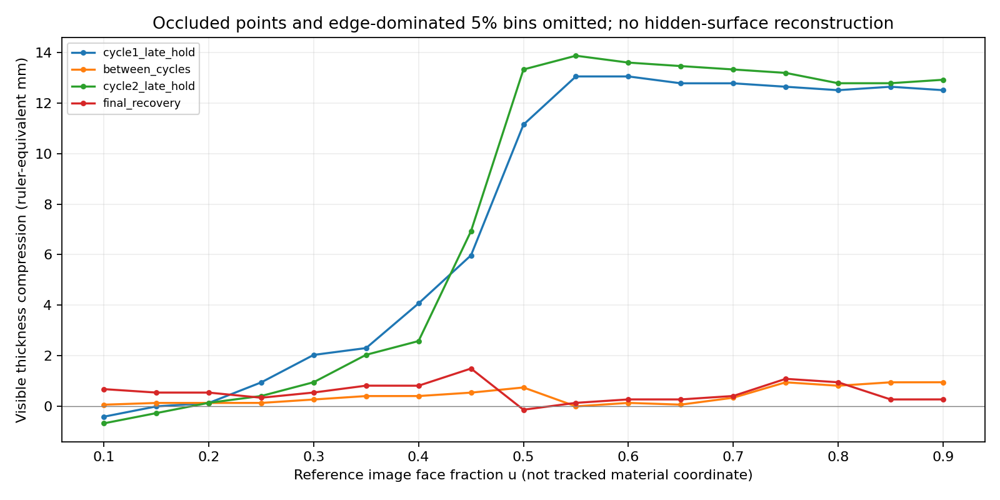
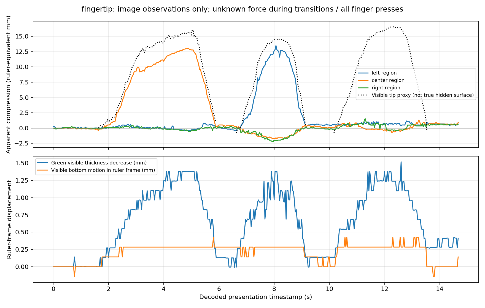

# Phase 7A: localized-loading experimental analysis

## Recommendation and scope

Use the **half-area bottle/card experiment first**, as conditional evidence for nonuniform loading. The simplest next numerical feature is a declared finite-area surface-traction patch with a free top surface outside the patch, reusing the existing material/element energy and nonlinear minimizer. Verify that feature independently before comparing it with the experiment. A prescribed traction patch is **not** rigid-indenter contact and must not be presented as the measured pressure distribution beneath the card.

The fingertip recording provides strong qualitative evidence of local deformation and recovery, but its unknown force and occluded surface prevent force–indentation or intrinsic stiffness identification. It should follow as qualitative contact/shape evidence, not the first quantitative force benchmark. Arbitrary fingertip interactions are not established as quantitatively predictable.

**No physics was implemented or parameters refitted.** All 461 tracked checkpoint files, including both source videos and the complete Stage 1–6 implementation/results, remain byte-identical. The baseline is commit `6aaf8b4ff77974603e64f8ebab6cb68c4ae9be31`, tag `baseline-v1-fullface-fem`. Mu = 6999.814990181902 Pa, alpha = 10 and beta = 0 remain frozen. New artifacts are confined to this directory; no commit or push was made for Phase 7A.

## Recordings and inventory

The filenames were verified against visible content, not classified from names alone:

| Experiment | Actual source | Frames | Last decoded timestamp | Visible interactions |
|---|---|---:|---:|---|
| Half-area card | `Videos/half area.mp4` | 452 | 15.031133 s | Two bottle loading/unloading cycles on the right portion of the sponge |
| Fingertip | `Videos/fingertip.mp4` | 441 | 14.664644 s | Central, left and right presses; card rests beside the specimen |

Both are 1920 × 1080, approximately 30 FPS. All **893 frames** were decoded sequentially with actual presentation timestamps; all intervals are positive and the largest is about 33.43 ms. No random seeking, temporal interpolation, trimming or re-encoding of originals was used. The overview sheets sample approximately every 0.5 s; event sheets use every third decoded frame within reviewed transition windows. Manifests join every tile/selected image to its zero-based source frame and timestamp.

Sources and hashes: [inventory](outputs/inventory.csv), [baseline provenance](outputs/baseline_provenance.json). The new recordings remain evaluation evidence, excluded from the original calibration split. Their use for any future fitting would require an explicitly separate model/data version and new validation separation. No generalized FEM prediction was run in this phase.

## Calibration and measurement meaning

The [previous extraction methods](../README.md) and [experimental report](../REPORT.md) informed the conventions: positive image y is downward, compression is a reduction in top-to-bottom visible thickness, missing measurements remain NaN, and ruler calibration is not forced to nominal geometry.

Separate ruler ROIs were selected for the new views. Visible labels/minor ticks support a 1 mm minor spacing. Forty ticks were detected in the half-area view and 31 in the finger view. Median adjacent spacing is 15 original pixels/mm in both; a quadratic y-to-relative-mm map accounts for local spacing variation. Tick-fit RMS is **0.0239 / 0.0299 mm**, respectively. This is tick agreement only, not specimen measurement accuracy. Ruler/face coplanarity, horizontal perspective and lens effects remain unverified. Some bottom observations extend slightly below the last fitted tick; this extrapolation is retained explicitly in the calibration bounds.

Reference-frame background features on the ruler/right-hand background register each image with a similarity transform. No frame failed the current registration criteria; median inlier RMS is 0.80 / 0.53 original pixels, with fitted scale spanning about 2% within each recording. Registration does not separate camera motion, ruler motion, parallax and reflections perfectly. Metric results below are **ruler-equivalent apparent measurements**.

Reference windows are 0.2–1.2 s: half-area with card present, finger with bare top. The visible foam profiles are sampled at 19 fixed reference-image face fractions u = 0.05…0.95. These are Eulerian image columns, not tracked material points. Median reference geometry is:

| View | Total visible height | Yellow color height | Green color height | Colored-face span / ruler-equivalent span |
|---|---:|---:|---:|---:|
| Half-area | 26.71 mm | 17.15 mm | 9.29 mm | 988 px / 65.87 mm |
| Fingertip | 26.80 mm | 17.24 mm | 9.55 mm | 1014 px / 67.60 mm |

The colored-face span excludes irregular outer fibres; horizontal ruler-equivalent length is not a calibrated true width. Nominal FEM geometry remains yellow 20 mm, green 7 mm and length 73 mm. The apparent layer discrepancy persists; no rescaling or parameter adjustment was made to conceal it.

For each column, visible top-to-bottom thickness is compared with its median reference, so bottom translation is not automatically counted as compression. Yellow/green color boundaries and bottom motion are also exported separately. Skin segmentation identifies a visible fingertip landmark; its depth is compared with the reference top and corrected for local visible bottom motion. **That landmark is not the hidden true top surface.** A conservative finger-silhouette span flags occluded columns. No surface is interpolated across the finger. A finger can disconnect the two yellow image regions, so both substantial visible lobes are retained rather than incorrectly discarding one.

There are **16,967 attempted spatial samples**. The fingertip data contain 123 missing top samples and 1,597 silhouette-occluded samples. Raw edge observations remain in CSVs, flagged; the outer 5% bins are omitted from profile plots because side retreat/curl can be mistaken for vertical top displacement. These choices are image observability limits, not physical-model corrections.

## Half-area card observations

### Contact geometry, overhang and orientation

The card begins near the middle of the visible face and extends beyond its right edge. Approximate manual picks on reference/loaded original frames give **0.49–0.51 projected front-face overlap fraction** and **15–17 ruler-equivalent mm of right overhang**. Assuming full 50 mm depth contact and the nominal 73 mm length would give roughly **1780–1880 mm²** (about half of 3650 mm²). This area is a conditional geometric scenario, **not a measured 3D bearing area**: depth overlap, hidden contact and out-of-plane orientation are unobserved.

The visible front card edge has a projected slope around 1.4–2.1°. Endpoint picks are approximately ±15 pixels, giving angle uncertainty of order 2°; perspective and card thickness also affect this line. The view neither proves a perfectly horizontal platen nor establishes a significant 3D tilt change. The bottle/card overhang and eccentric placement make a uniform pressure distribution unjustified. Local card bending cannot be separated confidently from perspective/edge ambiguity. [Manual geometry CSV](outputs/half_area/manual_geometry.csv) and [annotated evidence](outputs/half_area/geometry_00330.jpg) retain those assumptions.

### Timing, loading and hold quality

| Cycle | Possible bottle/card contact | Clear increasing foam depression | Candidate late hold | Lift/recovery onset | Separation bracket | Subsequent card-only observation |
|---|---|---|---|---|---|---|
| 1 | 1.6–1.9 s | 2.4–2.7 s | 4.2–6.2 s, frames 127–186 | 6.4–6.6 s | 7.0–7.2 s | 7.2–8.8 s |
| 2 | 8.8–9.0 s | 9.1–9.3 s | 10.0–12.3 s, frames 301–369 | 12.6–12.8 s | 13.1–13.3 s | 13.3 s to end |

Appearance of contact is not onset of the full gravitational load. The first cycle demonstrates this especially clearly: bottle/card proximity precedes the major depression. No hand is visible in the selected specimen crop, but the bottle top/possible grip is outside the field. **Hands-off loading cannot be independently certified.** Even the candidate holds have right-region ranges of 1.09 and 1.36 mm, standard deviations around 0.27 mm, and fitted descriptive trends of about 0.14 / 0.04 mm/s. They are relatively sustained loaded periods, not established stationary constant-force tests or identified creep.

The user's approximately 1000 ml water report is retained as an input assumption. If water density is 1 g/ml, tare is assumed 50–100 g and the bottle is fully supported, gravitational force would be **10.3005–10.791 N**, nominal 10.54575 N at 75 g tare. The bottle's total mass was not measured. Approximate volume, hidden support/hand force and motion mean these are conditional bookkeeping values, not measured forces or guaranteed force bounds. No observed pressure distribution or reaction is inferred. [Load assumptions](outputs/load_assumptions.csv) keep this distinction explicit.

### Nonuniform deformation and backing

| Window | Far-left u = 0.10–0.30 median apparent compression | Right u = 0.70–0.90 median | Median apparent green-thickness decrease | Median bottom shift in ruler frame |
|---|---:|---:|---:|---:|
| Cycle 1 candidate late hold | 0.27 mm | 12.58 mm | 1.23 mm | +0.41 mm |
| Cycle 2 candidate late hold | 0.14 mm | 12.92 mm | 0.96 mm | −0.27 mm |
| Between cycles | 0.13 mm | 0.82 mm | 0.27 mm | +0.14 mm |
| Final 14–15 s | 0.54 mm | 0.41 mm | 0.27 mm | −0.27 mm |

The strong right/left contrast is reliable qualitative evidence of nonuniform deformation. The transition extends into the nominally unloaded side: u around 0.3–0.5 shows a growing slope/curved shoulder before the depressed right plateau. Thus the undeformed portion cannot be modeled as an independent spring with no coupling. Color/marker geometry also shifts laterally; visible bending/shear-like distortion is supported qualitatively, but no material shear tensor or lateral strain law is identified from this view.

The green region's apparent thickness changes and its interface slopes under load, while its visible bottom moves by a few pixels. This flags the rigid-backing/support approximation for later review. It does not independently identify true green compliance: fibres, color interfaces, nonuniform shear, depth-plane motion and registration remain confounded. No backing modulus is assigned and no frozen assumption is silently changed.



## Fingertip observations

The clip contains three distinct presses. Contact is near image-face fractions **u ≈ 0.51, 0.14 and 0.70**. The lower visible finger silhouette spans roughly 140–178 pixels at peak, or about 9–12 ruler-equivalent mm. That is a silhouette descriptor, not true contact width/area or a pressure footprint; depth extent and contact evolution are hidden.

| Press | Contact bracket | Increasing/deep press interval | Unloading interval | Separation bracket | Conservative free window |
|---|---|---|---|---|---|
| Central | 1.6–1.8 s | 1.8–5.2 s | 5.2–5.8 s | 5.8–6.0 s | 6.0–6.5 s |
| Left | 6.5–6.8 s | 6.8–8.7 s | 8.7–9.1 s | 9.1–9.4 s | 9.4–10.1 s |
| Right | 10.1–10.4 s | 10.4–12.7 s | 12.7–13.5 s | 13.5–13.7 s | 13.7 s to end |

Depth varies throughout each press; no constant-force hold is known. The deepest detected **visible-tip contact proxies** are:

| Press | Frame / PTS | Pixel depth proxy | Ruler-equivalent proxy |
|---|---|---:|---:|
| Central | 151 / 5.032611 s | 238.5 px | 16.1 mm |
| Left | 245 / 8.165456 s | 218 px | 14.6 mm |
| Right | 367 / 12.231544 s | 246 px | 16.5 mm |

The true indentation maximum is not independently recovered because the finger hides the loaded top and its 3D path is unknown. CSV precision records algorithm output, not hundredth-millimetre accuracy. No force is assigned to any fingertip row, and no stiffness is inferred from depth.

Away from the central press, far-left/right broad-region envelope changes are about −0.27/−0.28 mm, comparable to the optical floor. However, the left press produces an opposite-side rise around **1.8 mm**, and the right press leaves about **0.8 mm** of apparent far-left compression in its deep window. Surrounding material is therefore only approximately stationary for part of the central press, not for the recording generally. Translation, edge curl, specimen history and nonuniform coupling matter. The exported [spatial observations](outputs/spatial_decay.csv) are one-dimensional visible-envelope changes; they do not identify radial 3D deformation decay or a material length scale.

The foam visibly fills back after each release and returns toward a near-flat outline. Residual profiles and backing-color changes remain at sub-millimetre levels. An image-column profile under the finger would conflate skin occlusion with foam motion, so those samples are excluded from spatial plots rather than reconstructed.



## Recovery and uncertainty

After conservative separation bounds, further visible recovery is approximately **0.34 / 0.68 mm** over 1.60 / 1.73 s for the half-area cycles, and **0.13 / 0.07 / 0.05 mm** over 0.50 / 0.70 / 0.96 s for the finger presses. These are differences of early/late window medians in broad loaded regions, not exponential fits. Most large recovery happens while transmitted force/contact is changing. Finger free tails are at or below practical resolution; the larger second half-area tail also has an uncertain equilibrium offset, reference/history and optical drift. Timestamp availability alone does not identify damping or a unique recovery timescale. None is estimated here.

The [uncertainty/limitations table](outputs/uncertainty_limitations.csv) distinguishes:

- Tick-fit residual from unverified face/ruler geometry. A separate assumed ±10% metric sensitivity follows prior analysis; it is not a confidence interval or certified bound.
- A practical 0.3 mm localization floor from measured threshold sensitivity. Across unoccluded samples, threshold-height range p95 is 0.41 mm (half-area) and 0.28 mm (finger), with extremes above 2 mm near steep/irregular boundaries. Pointwise CSV allowances increase where appropriate.
- Registration residuals from material motion/parallax, and visible color boundaries from physical interfaces.
- Visible tip proxy from hidden surface indentation, projected front overlap from true area, and image-edge angle from 3D platen orientation.
- Conditional gravity bookkeeping from independently measured reaction/pressure.

These allowances do not bound occlusion, arbitrary out-of-plane motion or unknown force. No normal-error model, statistical confidence interval or causal attribution to “human error” is claimed.

## What can independently assess a future model?

| Quantity | Assessment supported by these recordings |
|---|---|
| Local indentation depth | Partial visible-contact proxy; true hidden center depth unavailable |
| Vertical deformation profile | Useful half-area front-face envelope; partial fingertip profile outside occlusion/edges |
| Spatial decay | Qualitative/1D visible coupling; no radial 3D or intrinsic-length validation |
| Overall load reaction | Not independently measured; half-area gravity conditional, finger force unknown |
| Contact geometry | Projected position/span/overhang; no true depth patch or pressure distribution |
| Recovery shape | Qualitative return and descriptive residual profiles; no validated speed/damping |

See [validation_capabilities.csv](outputs/validation_capabilities.csv). The new evidence can challenge generalized spatial predictions without being used to refit the frozen model. It cannot make an unknown fingertip force into a measured input.

## Numerical implications — requirements only

Already available: a generic 3D hyperfoam energy/stress kernel, Tet4 energy/gradient assembly, structured mesh generation, orientation checks, an energy-minimizing equilibrium core, and exact external nodal-load work in the objective. Those mathematical pieces need not be rewritten.

**Not yet supported by the current scenario solver:** localized top loading with unconstrained top z outside the loaded region. `BlockSolver` currently eliminates all top z DOFs using one global platen displacement. Merely adding patch nodal forces to those fixed DOFs does not create a local-load simulator. Its one-dimensional force/root parameter is also not a general nonuniform contact solution.

For the smallest next feature, introduce a separate reviewed boundary-condition scenario with bottom normal support/minimum rigid-motion pins retained, top normal DOFs released, and a prescribed finite patch traction integrated consistently into nodal loads. Parameterize patch location/extent and declared distribution. Check resultant force and moment, energy/work gradients, free residual, support reactions, positive Jacobians, translation invariance and mesh convergence on independent synthetic benchmarks before experimental comparison. Preserve the frozen full-face implementation and parameters.

Patch-edge gradients and local deep deformation require substantially finer meshes than the current 27-node homogeneous demonstration, especially through thickness and across the patch boundary. Existing affine mesh agreement is not a localized-load convergence study. The dense quasi-Newton method may require smaller load continuation steps, better conditioning or later sparse methods; successful homogeneous solves do not certify robustness for these shapes. Partial support/opening, lateral slip and backing compliance remain additional assumptions to test, not parameters to invent now.

A rigid card or finger additionally requires a finite indenter geometry, unknown normal contact reaction, nonpenetration and separation/contact-set handling; card tilt/rotation and loading moment may matter. Prescribed patch traction cannot supply those effects. The half-area experiment's approximate load/clear spatial contrast makes it the better first *conditional* comparison, but uniform pressure would remain an assumed numerical input. Weigh the bottle and characterize plate overlap/pose/support before claiming quantitative force-based validation. Use the unknown-force finger clip later for qualitative shape/contact checks, or obtain independently measured force before a quantitative test.

## Reproduction and artifacts

From the repository root, using installed NumPy, SciPy, OpenCV, pandas and Matplotlib:

```sh
python -B analysis/localized_experiments/inspect_videos.py
python -B analysis/localized_experiments/analyze.py
python -B analysis/localized_experiments/refine_sheets.py
python -B analysis/localized_experiments/summarize.py
python -B -m unittest discover -s analysis/localized_experiments -p test_analysis.py -v
```

These write only this stage's `outputs/`. The inventory first checks exact checkpoint bytes against the frozen tag, then protects their SHA-256 hashes. No previous-stage generation command or video extraction was rerun. The processing configuration/ROIs, reference windows, selected frames and reviewed event choices are recorded in source and [analysis_configuration.json](outputs/analysis_configuration.json).

Main outputs: [inventory](outputs/inventory.csv), [overview tile manifest](outputs/overview_manifest.csv), [event tile manifest](outputs/event_review_manifest.csv), [phases](outputs/phases.csv), [window summaries](outputs/window_summary.csv), [fingertip peaks](outputs/fingertip_peaks.csv), [reference geometry](outputs/reference_geometry.csv), [hold quality](outputs/hold_quality.csv), [recovery observations](outputs/recovery_observations.csv) and [measurement quality](outputs/measurement_quality.csv). Each experiment folder contains timestamps, selected original/annotated frames, contact sheets, calibration evidence, per-frame measurements, per-column profiles and plots. Maximum-proxy fingertip frames have separate original/annotated evidence. Manual card geometry picks are retained separately from automatic profile measurements.

Five new tests pass: disconnected visible lobes remain separate/retained, backing observations survive hidden yellow, every timestamp/profile/tile join is consistent, unknown force/hidden-surface semantics are preserved, and all 461 baseline file hashes match. Selected overlays, event sheets, calibration evidence and plots were reviewed visually. Initial detector lobe-loss/occlusion and edge-interpretation issues were corrected before final reporting; raw NaNs/quality flags remain visible.

**Stop point:** experimental analysis and technical recommendation only. No localized-load FEM, contact solver, damping or new material calibration is included. Implementation awaits approval.
