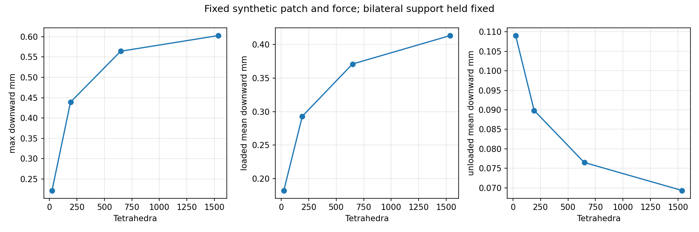

# Phase 7C — stabilization and usable simulator

**Delivered:** a unified full-face/localized CLI, verified unilateral bottom support, solved-state renders/GIFs, and a bounded refinement diagnosis. **Not delivered:** a converged nominal half-area prediction. The single frozen 10.54575 N attempt failed and was not retried. Localized traction remains an experimental capability.

The Stage 1–6 material, element, full-face solver, calibration, observations and demonstration files are unchanged. Mu = **6999.814990181902 Pa**, alpha = **10**, beta = **0**; yellow geometry 73 × 50 × 20 mm above rigid 7 mm backing. The [Phase 7B report](REPORT.md) is retained as a historical record. No video extraction, parameter fitting, rigid-card collision, damping or new research phase was undertaken.

## Focused mesh diagnosis

Only one additional bilateral refinement, **8/8/4**, was solved. The prior centered synthetic 20 × 30 mm, 0.3 N protocol and exact load integration were held fixed. Existing solved states were reused. [Machine-readable diagnosis](phase7c/mesh_diagnosis.json) includes cell spacing, footprint coverage, peak location and deformation-gradient conditioning.

| Cells | Tets | Peak down mm | Loaded mean mm | Unloaded mean mm | Min J | Runtime s |
|---|---:|---:|---:|---:|---:|---:|
| 2/2/1 | 24 | 0.221987 | 0.182508 | 0.109019 | 0.988889 | 0.836 |
| 4/4/2 | 192 | 0.438919 | 0.293019 | 0.089839 | 0.970653 | 12.027 |
| 6/6/3 | 648 | 0.563996 | 0.370801 | 0.076496 | 0.953231 | 53.151 |
| 8/8/4 | 1536 | 0.602425 | 0.413163 | 0.069331 | 0.944957 | 187.480 |

- At 6/6/3 the patch spans only **1.64 × 3.6 cells**, with **three top vertices inside it**. At 8/8/4 this becomes **2.19 × 4.8 cells**, with 15 top vertices inside. Coarse linear tetrahedra under-resolve local gradients/bending and give an overly stiff response. Through-thickness resolution also changes; this study does not uniquely partition each discretization error.
- Exact clipping passes force, centroid, moment and nonaffine energy-gradient tests. Area stays 600 mm² and force stays 0.3 N. The dependence is not an arbitrary nearest-node footprint change.
- Every mesh's maximum is at **(36.5,25,27) mm**, the patch center, **10 mm from its closest edge**. There is no evidence here that an edge singularity drives the peak displacement. Traction jumps can make edge stresses sensitive; their convergence was not established.
- The last two meshes have free residuals about 4e-8 N, min J above 0.94, and maximum deformation-gradient condition numbers about **1.04**. Severe distortion or failure to equilibrate does not explain this small-load refinement trend.
- The next peak change is **6.81%**, down from 28.50%. The loaded-area mean changes **11.42%**, and the unloaded mean **−9.37%**. Area averaging is therefore **not consistently more stable** than peak displacement. No continuum limit, tolerance-certified displacement, or stress convergence is claimed.



Refinement stops here. Dense inverse-BFGS cost is already substantial; adding more global levels would not efficiently finish the assignment. The packaged localized default is **4/4/2**, selected for affordable exploratory use, not accuracy certification. Users can explicitly request 6/6/3 or another even-x/y mesh. The old 65% platen compression cap is not applied to localized deformation.

## Minimal unilateral backing support

The bilateral tensile reactions were local, despite a positive overall support resultant. At 0.3 N their total was 0.000723 N on 192 tets and 0.008187 N on 648 tets. Increasing refinement does not remove the inconsistency of a resting support pulling downward.

`support.py` adds a small active-set wrapper around the existing positive-J inverse-BFGS subproblem. For each bottom node:

`gap = z - z_support >= 0`, `reaction >= 0`, `gap * reaction = 0`.

Active bottom z DOFs are eliminated at the plane; inactive bottom z DOFs are free. Negative active reactions release nodes. Penetrating inactive subproblem nodes are added back to contact. Each changed set is re-equilibrated with the **same material energy and analytical gradient**, retaining the horizontal anchors. Tangential bottom motion remains free except for those three gauge DOFs. There is no penalty stiffness and **no reaction clipping**. This is nodal contact with an infinite flat bottom plane, not a general collision solver.

Intermediate active-set subproblems may violate contact; only final KKT-admissible states are returned as accepted load states. This method is local and may fail or cycle; a repeated set, 20-set limit, iteration limit, positive-J/line-search failure or wall-time budget produces explicit failure. An intentionally grossly unsupported initial contact set did not converge in a pilot; tests instead exercise stable reactivation of a missing central contact node. No general convergence guarantee is implied.

Numerical acceptance uses the unchanged **5e-8 N** free-force/dual tolerance and **1e-10 m** primal gap tolerance. Normal contact reactions are nonnegative within that force tolerance; tiny inactive nodal force residuals are not support reactions. Only eliminated contact DOFs supply normal reactions. [Saved-reaction audit](phase7c/support_audit.json) rechecks actual exports independently of the displayed diagnostics.

| Synthetic case | Active / lifted bottom nodes | Max lift mm | Peak down mm | Loaded mean mm | Free residual N | Solve time s |
|---|---|---:|---:|---:|---:|---:|
| Eccentric 2/2/1 | 6 / 3 | 0.05839 | 0.289484 | 0.199308 | 2.13e-8 | 1.170 |
| Centered 4/4/2 | 21 / 4 | 0.00316 | 0.438975 | 0.293030 | 4.52e-8 | 13.714 |
| Centered 6/6/3 | 31 / 18 | 0.04390 | 0.565737 | 0.371868 | 4.16e-8 | 108.203 |

All audited cases have zero minimum gap, zero tensile **actual contact** reaction, zero complementarity product to exported precision, positive Jacobians, and force imbalances below 4.1e-8 N. Releasing support changes centered peak displacement by only about 0.013% / 0.309% on the two meshes: it fixes physical admissibility in these cases but does not fix spatial under-resolution. The original bilateral option remains explicitly accessible for reproduction.

## CLI and outputs

From the repository root:

```powershell
$env:OPENBLAS_NUM_THREADS='1'
python -B -m analysis.localized_fem.simulator --help
python -B -m analysis.localized_fem.simulator full-face --force 6.5 --sequence --output runs/fullface_6p5
python -B -m analysis.localized_fem.simulator localized --force 0.3 --patch-length-mm 20 --patch-width-mm 30 --center-x-mm 18.25 --center-y-mm 25 --mesh 4 4 2 --support unilateral --sequence --output runs/patch_0p3
```

Choose new output paths. Inputs are total force N, reference x/y center and patch lengths mm; internal/export positions are metres. Rectangles are clipped to the reference top and force normalized over the overlap. Zero overlap, invalid mesh/force/lengths, and existing output paths are rejected. Full-face mode calls the unchanged `demo.model` API with its frozen 2/2/2 mesh and 13 mm search limit. It does not implement patch loading by fixing the top to a platen.

Localized mode defaults to unilateral support, 4/4/2 cells, load-factor step 0.25 and a **180 s** nonlinear solve budget. `--load-step` and `--time-limit-s` are explicit. Unlike the historical Phase 7B CLI, the packaged CLI does not automatically retry a failed step with smaller increments. The wall-time check is once per nonlinear iteration, so one iteration can overrun the budget slightly. Existing `simulate.py` remains the legacy bilateral entry point.

Successful runs export reference/solved vertices plus nodal applied loads (`nodes.csv`), tetrahedra, boundary triangles, reactions, diagnostics, static 3D image, and localized iteration/continuation/contact records. Full-face applied nodal loads come from the solved platen reactions; they are not imposed uniform patch pressure. Localized contact CSV contains actual support reactions, active flags and gaps; no tensile force is hidden by truncation.

`--sequence` exports discrete **actual converged equilibrium** coordinates in NPZ, frame-to-state/force mapping, PNGs and GIF. The unloading visualization reverses the same reversible hyperelastic equilibria. **No interpolated mesh states, measured-motion replay, physical playback times, hysteresis or damping are implied.** Full-face iteration diagnostics describe the final equilibrium, not all force-root evaluations. Static localized renders show the reference footprint, not a rigid card.

Examples: [full-face GIF](phase7c/cli_fullface/sequence/loading_unloading.gif), [localized GIF](phase7c/cli_localized/sequence/loading_unloading.gif), [localized final 3D](phase7c/cli_localized/deformed.png). The localized GIF uses the verified inexpensive 2/2/1 eccentric example; it is not a resolution-certified shape prediction.

## One half-area evaluation after settings freeze

[Protocol](phase7c/frozen_evaluation_protocol.json) was written before the run, including numerical source hashes. The assumed footprint is the right **36.5 × 50 mm** at center **(54.75,25) mm**. Force **10.54575 N** assumes nominal 1000 g water, **unmeasured assumed 75 g tare**, g=9.81 and full supported bottle weight. Pressure would be about **5.78 kPa** if the uniform reference traction assumption held. The protocol fixes 4/4/2, unilateral support, factor increments 0.125, no retry, 600 iterations/subproblem, unchanged residual/gap tolerances, 180 s budget. These settings were selected for gradual bounded exploration after synthetic verification, not experimental agreement.

The single attempt took **55.98 s** and reached accepted steps through factor 0.875 (**9.22753 N**). At factor 1 the contact set needed further release; its next subproblem failed after 600 iterations with **0.199 N residual**, min J about **0.00157**. Positive-J protection avoided inversion but did not provide a converged equilibrium. This indicates a serious robustness/distortion limit for that attempted loading, not proof that the physical sponge has no equilibrium. No nominal solved vertices, rendered failed state or error score were published. The run was not adjusted or repeated. See [failure diagnostics](phase7c/half_area_once/failure.json).

| Quantity | Phase 7A observation, cycles 1 / 2 | Nominal localized prediction |
|---|---|---|
| Loaded-right apparent compression | 12.58 / 12.92 mm | Unavailable: solve failed |
| Unloaded-left apparent compression | 0.27 / 0.14 mm | Unavailable: solve failed |
| Front-face spatial profile | Right depression with a shoulder extending left | No admissible nominal profile |
| Qualitative shape | Strongly nonuniform, coupled deformation | Small synthetic solves show coupling only; no nominal-force validation |

[Comparison JSON](phase7c/half_area_comparison.json) and [CSV](phase7c/half_area_comparison.csv) explicitly leave predictions/errors missing. Actual force, depth overlap, pressure, card planarity/tilt and supported weight are uncertain; visible bottom/green-region changes also challenge the support approximation. A traction patch cannot enforce rigid-card planarity or contact redistribution. Even a successful run on this mesh would have remained exploratory. Fingertip observations remain qualitative because force is unknown; no force-depth stiffness or recovery timescale is inferred.

## Verification, preservation and submission status

**18 localized/support/CLI tests pass**, including nine Phase 7B tests, five contact tests and four packaging tests. They cover force/moment integration, gradient consistency, zero load, positive J, reflection/translation, full-top analytical agreement, contact lift-off/reactivation, complementarity, energy decrease from releasing bilateral constraints, force/moment balance, output exclusivity and timeout failure without solved geometry. Every localized GIF state is independently re-evaluated for equilibrium/KKT and positive J. **All 36 frozen regression tests pass.** The full-face example remains 5.10350445 mm compression at 6.5 N. Logs are retained in `phase7c/`.

```powershell
python -B demo/check.py
python -B -m unittest analysis.localized_fem.test_localized analysis.localized_fem.test_support analysis.localized_fem.test_cli -v
python -B -m analysis.localized_fem.diagnose
python -B -m analysis.localized_fem.check_package
```

README documentation is updated as requested; historical freeze manifests and Phase 7A provenance are not rewritten. Their strict whole-checkpoint checks therefore identify the authorized README change. The Phase 7C package checker requires that **README is the only historical Stage 1–6 tracked change**, verifies every other baseline file against the tag, verifies all previous results/video bytes, and checks the frozen evaluation source hashes. Do not regenerate or replace historical measurements to satisfy a documentation hash.

Final package audit: **460 tagged files excluding README are byte-identical**, and **764 preexisting nonbaseline/baseline files** in the preservation inventory are unchanged. Three Phase 7B adapter/export source files changed intentionally: retaining accepted solved-state snapshots, adding a wall-time guard, and exporting unilateral contact data/actual reactions. Previous Phase 7B results and report are intact. The historical Phase 7A suite now has four passing methods and one expected README snapshot failure; the historical baseline checker reports only `Organized package changed: README.md`. These are recorded, not presented as passing legacy checks. The new explicit-delta package check passes. Early Phase 7C pilot tensile-total diagnostics were corrected to use exported actual reactions rather than inactive residual roundoff; [correction note](phase7c/export_correction.json) records this, without changing solved fields.

Remaining blockers for **quantitative localized validation** are unresolved displacement convergence, failed nominal-force equilibrium, and uncertain real card/force/backing assumptions. General rigid-card contact and identifiable recovery remain outside this deliverable. Submission packaging must use the current checker alongside the historical manifests and disclose the README documentation delta; new Phase 7A–7C files are not part of the validated Stage 6 tag. No new commit, push, simulation platform port or subsequent development phase was started.
