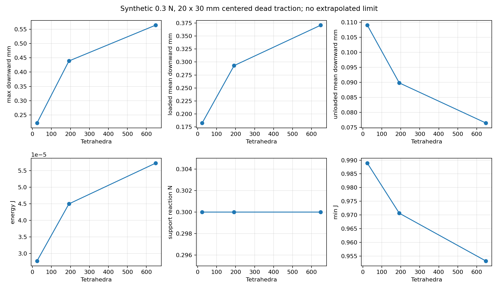
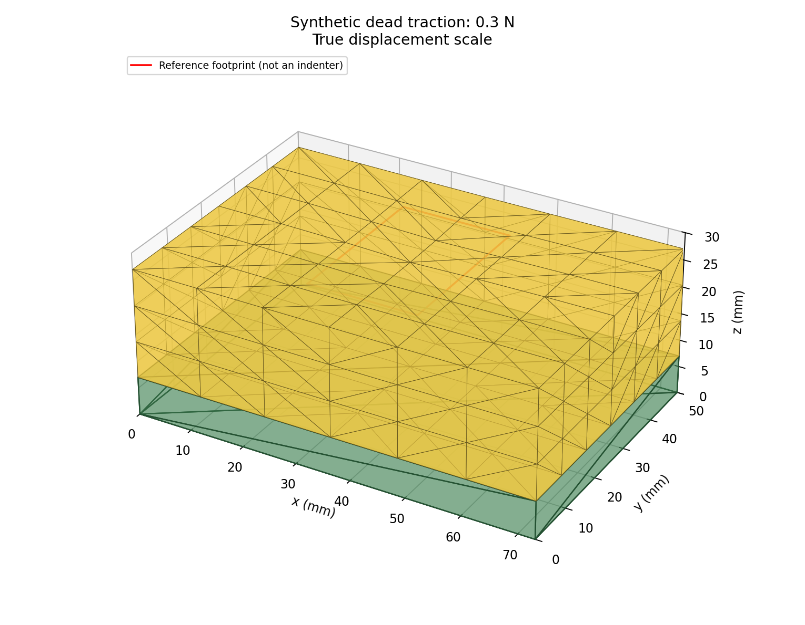

# Phase 7B — finite-area reference dead traction

This separate scenario adds prescribed spatial loading to the frozen hyperelastic FEM system. It passes independent integration and equilibrium checks. **Local displacement is not mesh-converged, and no experimental validation is claimed.** No new video was extracted, no measurement or material parameter was changed, and no official half-area comparison was run.

## Frozen mechanics and scenario boundary conditions

The baseline is annotated tag `baseline-v1-fullface-fem`, peeled commit `6aaf8b4ff77974603e64f8ebab6cb68c4ae9be31`. Retained parameters are mu = **6999.814990181902 Pa**, alpha = **10**, beta = **0**. Yellow foam is **73 × 50 × 20 mm**, at z = 7–27 mm. The **7 mm rigid green backing** supplies a support plane and visual geometry, without deformable DOFs. There is no refit or new material version.

The unchanged material energy, analytical stress/global assembly, objective scaling and positive-J segment safeguard are imported from the verified modules. The governing potential is

`Pi(x) = sum_e V_e W(F_e) - sum_a f_a · (x_a-X_a)`.

Its free-coordinate gradient is the assembled internal force minus prescribed external force. Downward forces and downward displacements give positive external work, subtracted from strain energy. The default physical stopping condition is the frozen **maximum absolute free-DOF residual ≤ 5e-8 N**. Objective and optimizer coordinates retain the frozen dimensionless scaling.

Unlike the original global platen scenario, **all top x/y/z coordinates are free**. Only bottom z coordinates and the existing three minimal horizontal anchor DOFs are fixed: bottom-origin x/y and bottom-x-corner y. The latter remove in-plane translation/yaw without bonding the bottom. The internal displacement argument of the inherited objective is always zero and does not impose a top height. The former 65% full-face displacement cap is not used.

Bottom z fixation is a **bilateral plane**: it can supply tension. This is not unilateral table/backing separation or a friction law. Reactions are the internal-minus-external residual on eliminated DOFs; positive z is upward. Signed tensile reactions are exported rather than suppressed.

The frozen optimizer also mixes convergence with a policy rejecting tensile bottom reactions. Initial localized pilot solves hit that rejection despite small free residuals. `minimize.py` therefore adapts its small safeguarded inverse-BFGS loop to return signed bilateral reactions. It retains analytical gradients, Armijo backtracking, the original positive-J feasible-step bound, and the 600-iteration budget per continuation attempt. No constitutive/element formula is copied and no shared source was edited. The inherited full-face entry points are disabled in this scenario to prevent accidental mixed boundary conditions.

## Exact finite-area load discretization

`traction.py` intersects every reference top triangle with an axis-aligned rectangle using polygon clipping. Each resulting convex polygon is fan-triangulated. Linear reference shape functions are integrated exactly on each fan triangle: area times the mean of the three vertex shape-function values. Thus

`f_a = -(F/A_clipped) e_z ∫_patch N_a dA`.

Pressure is normalized by the **actual clipped area**. The same force vector is multiplied by successive continuation factors, initially 0.25, 0.50, 0.75, 1.00; failed attempts halve the factor increment, down to 1/1024. No load redistribution occurs as the shape moves. Area, first moment and total force are preserved across discretizations, including partial triangles and patches extending outside the sponge. Zero overlap is rejected. No nearest-node selection is used.

This is a uniform **reference-area dead traction** with fixed spatial downward direction. Equivalent nodal forces are work-consistent for the piecewise-linear FEM displacement. The pressure is not current-area follower pressure. The footprint is tied to reference material coordinates. There is no card, rigid indenter, prescribed top planarity, moment-transmitting rigid body, rotating platen, pressure redistribution, friction, changing contact, damping or dynamics. The equivalent nodal forces can include vertices outside the rectangle because their shape functions overlap the rectangle; that is consistent integration, not load smearing by nearest nodes.

The new mesh generator reflects the verified structured quarter-block tessellation about x/y midplanes. Shared integer-grid IDs give conforming interfaces; orientations are corrected to positive reference volume. This supplies exact geometric reflection symmetry, which the original directional Freudenthal mesh need not possess. It requires positive even x/y cell counts and positive integer z count, without changing any baseline mesh.

## Independent protocol and checks

All choices are synthetic: centered **20 × 30 mm** rectangle at **(36.5,25) mm**, **0.3 N** (500 Pa). Coarse progression uses 0.1, 0.3 and 0.6 N. Placement tests use x = 18.25, 36.5 and 54.75 mm, at y = 25 mm. These are not inferred bottle/finger forces or an estimate of card contact. No response from the evaluation recordings was used to select them.

Run `python -B -m unittest analysis.localized_fem.test_localized -v` for nine tests. The independent driver records protocol, histories, continuation factors, nodal forces/reactions and diagnostics under `verification/`.

| Check | Evidence / acceptance |
|---|---|
| A Zero load | Undeformed coordinates within 1e-15 m; negligible energy |
| B Force and clipped area | Three meshes, centered/eccentric/partly outside rectangles; resultant to 1e-14 N, area to 15 decimal places |
| C Centroid / reference moment | Analytical clipped rectangle centroid to 1e-15 m; moment `(-F cy,F cx,0)` to 1e-15 Nm |
| D Placement | Distinct force vectors; left/right reflected displacement agrees within 2e-9 m |
| E Nonaffine gradient | All coarse free coordinates, centered finite differences with h=1e-6 in scaled coordinates; atol 2e-10, rtol 2e-6 |
| F Equilibrium | Free force tolerance 5e-8 N; balance thresholds account for summing nodal residuals |
| G Positive J | Every accepted history entry positive; inverted configurations rejected; sampled full safeguarded step remains positive |
| H Refinement | Three discretizations, table below; no inferred continuum limit |
| I Symmetry | x/y reflections, including horizontal displacement after removing anchor-dependent uniform translation; atol 2e-9 m |
| J Translation | Reference/support translated from z=7 to 57 mm; displacement within 2e-9 m, energy within 1e-11 J |
| K Regression | All 36 existing frozen full-face tests pass; baseline checker PASS; five Phase 7A tests pass |
| Extra analytical check | Full-top uniform traction gives the independent free-uniaxial material solution within 2e-9 m; energy rtol 2e-6, atol 1e-12 J |
| Failure handling | One-iteration budget deliberately fails; no unconverged geometry is exported as a solution |

The initial eight-test run is retained in `verification/localized.log`; `verification/localized_final.log` records the additional full-top analytical check and all nine passing tests. An initial energy assertion for that extra check was stricter than the fixed force stopping tolerance warrants (difference 9.98e-12 J, about 5.5e-7 relative). Its analytical-comparison tolerance was made explicit as above; **the solver residual tolerance was not changed**.

## Mesh-refinement results

The loaded/unloaded means are exact reference-area integrals of the piecewise-linear top displacement, using the patch weights and their whole-top complement. Maximum downward displacement is over all FEM nodes. These are distinct quantities.

| Cells x/y/z | Nodes / tets / free DOFs | Peak down mm | Loaded mean mm | Unloaded mean mm | Energy J | Support z N | Min J | Iterations |
|---|---|---:|---:|---:|---:|---:|---:|---:|
| 2/2/1 | 18 / 24 / 42 | 0.221987 | 0.182508 | 0.109019 | 2.77110e-5 | 0.299999989 | 0.988889 | 181 |
| 4/4/2 | 75 / 192 / 197 | 0.438919 | 0.293019 | 0.089839 | 4.49377e-5 | 0.299999894 | 0.970653 | 430 |
| 6/6/3 | 196 / 648 / 536 | 0.563996 | 0.370801 | 0.076496 | 5.72127e-5 | 0.299999978 | 0.953231 | 580 |

Peak displacement rises about **98%**, then **28.5%**; loaded mean rises about **60.6%**, then **26.5%**. Energy rises and unloaded mean decreases. Applied load/centroid stay fixed, so this is spatial discretization sensitivity, not a drifting footprint. The meshes are systematically refined but their errors have not reached a demonstrated asymptotic regime; extrapolating a continuum response or adopting the 48-tet baseline for localized accuracy is unjustified. This is force-driven compliance increasing with refinement, not a solver residual failure.



## Practical performance and support limitations

Detailed measured runtimes, summed accepted iterations, all continuation attempts, free residuals and Jacobians are in `verification/cases.csv` and each case's `diagnostics.json`. Iterations are summed across accepted load steps, not the maximum iterations of a single step. Failed attempts have explicit reasons. Runtime depends on CPU/BLAS/thread settings; the recorded driver used `OPENBLAS_NUM_THREADS=1`. Dense inverse-BFGS stores O(n_free²) entries and performs dense matrix operations, with repeated element SVDs and feasibility solves during line search. Refinement is already expensive for a small static body; this is not real-time interaction.

| Tets | Accepted iterations | Solve runtime s | Max free residual N | Status |
|---:|---:|---:|---:|---|
| 24 | 181 | 0.836 | 1.73e-8 | Converged |
| 192 | 430 | 12.027 | 4.00e-8 | Converged |
| 648 | 580 | 53.151 | 3.59e-8 | Converged |

`audit_outputs.py` independently re-evaluated all seven saved nodal configurations, connectivity, loads, reactions, energy and potential without repeating the nonlinear solves. All pass. Across them the largest net force imbalance is 1.07e-7 N and largest current moment imbalance is 1.43e-8 Nm; sums need not equal the per-DOF stopping tolerance. The deliberate one-iteration failure ends at residual 0.0441 N, min J about 0.992, and is documented in `verification/expected_failure.json`.

The coarse 0.1/0.3/0.6 N peak displacements are 0.0721/0.2220/0.4630 mm. Both off-center 0.3 N cases give peak 0.28587 mm and loaded mean 0.19875 mm, with reflected response. All production cases converged at the unchanged tolerance with positive J. No bottle-scale force was attempted or implied to be supported by these tests.

Both off-center cases require about **0.00255 N total tensile bottom reaction**. Even the centered 192/648-tet meshes have negative bottom nodal reactions. Small signed reactions are consistent with the declared bilateral idealization, but do not establish that a freely resting specimen stays in contact. Reaction-force balance is assessed in the current configuration; the analytical applied-load moment test uses reference geometry. The external moment can change with tangential movement under a dead load. Solver diagnostics include the actual current force/moment balance.

The total tensile reaction is **0.000723 N** on the centered 192-tet mesh and **0.008187 N** on the centered 648-tet mesh. Its increase is another reason not to infer physical support-contact accuracy from coarse results.

The smallest sound next solver improvement is a **limited-memory quasi-Newton iteration** retaining this exact potential, physical residual stopping rule, positive-J bound and line search, verified against these cases. That reduces dense storage/work without changing the physics. Sparse tangent/Newton methods may be warranted later. Refinement near footprint edges and through thickness is also needed, with conforming transitions and renewed force/moment/symmetry tests. A positive-J local stationary solution is not proof of unique global stability or a dynamic trajectory.

## Usage and exported artifacts

From the repository root (PowerShell), start small:

```powershell
$env:OPENBLAS_NUM_THREADS='1'
python -B -m analysis.localized_fem.simulate --help
python -B -m analysis.localized_fem.simulate --force 0.1 --patch-length-mm 20 --patch-width-mm 30 --center-x-mm 36.5 --center-y-mm 25 --mesh 2 2 1 --output analysis/localized_fem/my_new_run
python -B -m analysis.localized_fem.verify_localized --output analysis/localized_fem/my_new_verification
```

Output paths must be new; existing results are refused. Center/length CLI units are mm; internal/export coordinates are metres, forces N, energy J and pressure Pa. `--force` must be finite/nonnegative, patch lengths finite/positive, and overlap nonzero. The only supported distribution is `--distribution uniform-reference`. Out-of-bounds rectangles are intentionally clipped with force renormalized over the overlap; diagnostics expose area and centroid. This can increase pressure and is not a physical assertion about an overhanging card.

Integrity: the driver SHA-256 compared **677 preexisting analysis/video/document/demo files** before and after and found no changes. Git reports no tracked difference from the baseline tag. The documented baseline checker separately passes its 460-file organized manifest and approved privacy-removal exception. New work is confined to this directory; Phase 7A outputs and original recordings remain untouched. The report, CLI example, final nine-test log and saved-output audit are supplemental artifacts produced after the driver; the original run logs remain intact.

Each converged run exports reference/solved nodal coordinates and force vectors (`nodes.csv`), tetrahedra, boundary triangles, support reactions, iteration and continuation CSVs, JSON diagnostics, and a static 3D render. Render displacements have true scale; the red outline is the **reference** rectangle, not a card or a contact surface. `cli_example/` is a separately exercised CLI example. Failure produces a failure JSON and nonzero exit without solved geometry. A repeated output directory is rejected before writing.



## Readiness and next review

The prescribed-traction implementation is ready for review and additional **synthetic** numerical work. It is **not yet ready to support a quantitative frozen-prediction claim against the half-area card video**: spatial convergence is unresolved, tested loads are sub-newton, bottom separation is excluded, and the card pressure/rotation/contact footprint is unknown. A user-approved exploratory comparison could eventually test this explicitly declared approximation, but should not be presented as verified rigid-card mechanics or used for silent calibration.

Before an official comparison: freeze load/support assumptions independently of the measured depression, establish sufficient refinement and solver robustness at the selected force, and decide whether observed card planarity/tilt requires a separate rigid-contact implementation. Finger forces remain unknown. No arbitrary finger force, damping or experimental stiffness is introduced. Stop here for review; no official comparison or subsequent contact implementation was run.
