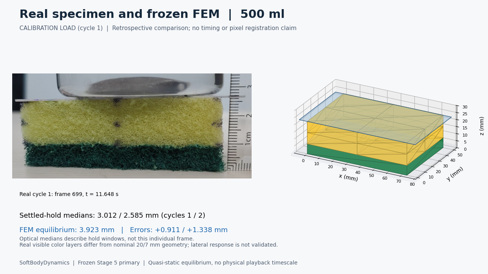
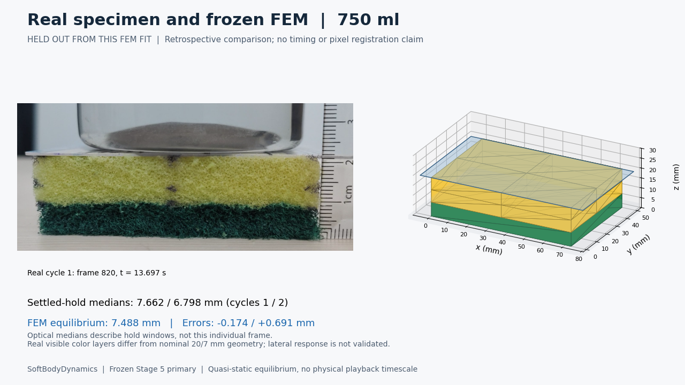
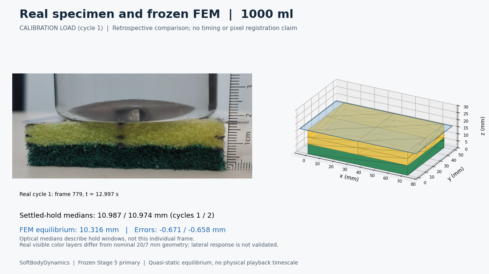
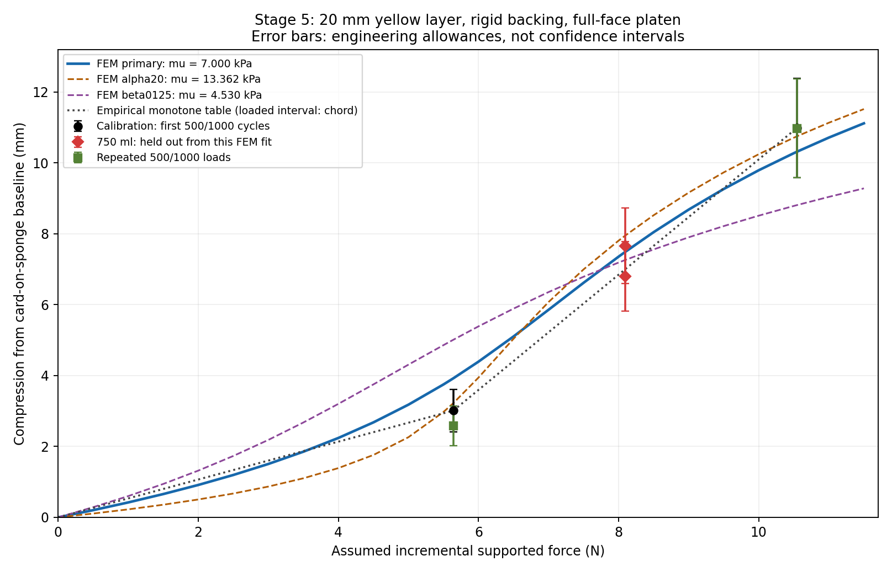

# Real specimen versus full-face FEM

This page renders directly on GitHub. No local HTML viewer or Python setup is needed to inspect these existing results.

[Watch the demo GIF](outputs/demonstration.gif) | [Download the 45.2-second MP4](https://github.com/Goutham-IITJ/SoftBodyDynamics/raw/refs/heads/main/demo/outputs/demonstration.mp4) | [Setup and simulator commands](../README.md)

> GitHub may not preview the MP4. Download it and open it locally, or use the GIF. The animation is a sequence of quasi-static equilibria, not a measured physical recovery timeline.

## 500 ml calibration case

The first-cycle observation is 3.012 mm; primary FEM predicts 3.923 mm. This mismatch remains unresolved.

## 750 ml retrospective evaluation

Observed cycles: 7.662 / 6.798 mm; primary FEM: 7.488 mm. These observations were excluded from FEM fitting but already inspected during earlier model selection, so this is not independent prospective validation.

## 1000 ml calibration case

Observed cycles: 10.987 / 10.974 mm; primary FEM: 10.316 mm.

## Scope and evidence

The primary model uses mu = 6999.814990181902 Pa, alpha = 10 and beta = 0, nominal yellow foam 73 x 50 x 20 mm and rigid 7 mm backing. Nominal forces assume an unmeasured 75 g bottle tare and stationary full support. No damping or physical recovery time is identified. The separate localized traction extension is experimental; its nominal bottle-force prediction failed and its small-load mesh dependence remains.

[Calibration report](../analysis/calibration/REPORT.md) | [Technical summary](TECHNICAL_SUMMARY.md) | [Localized limitations](../analysis/localized_fem/PHASE7C_REPORT.md)
